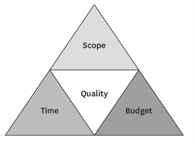
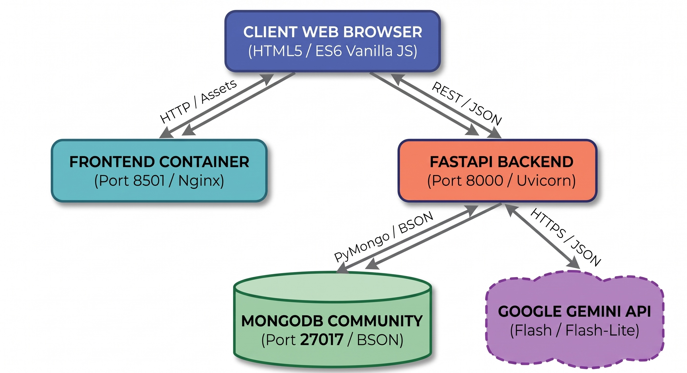
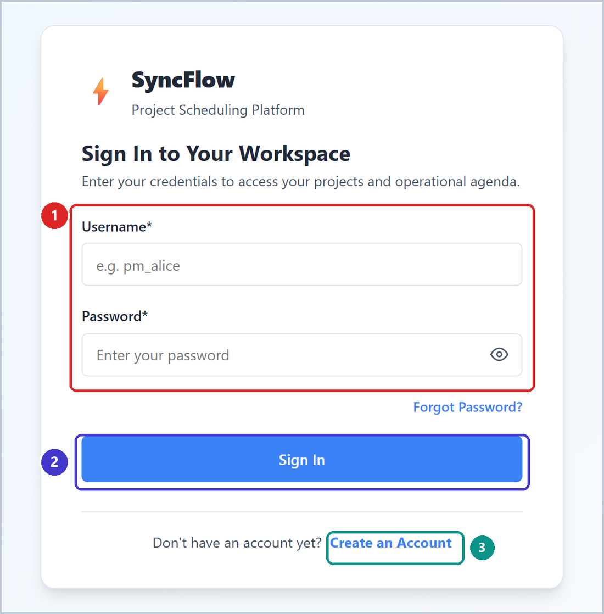
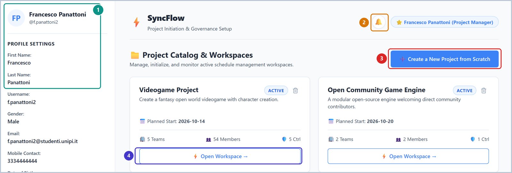
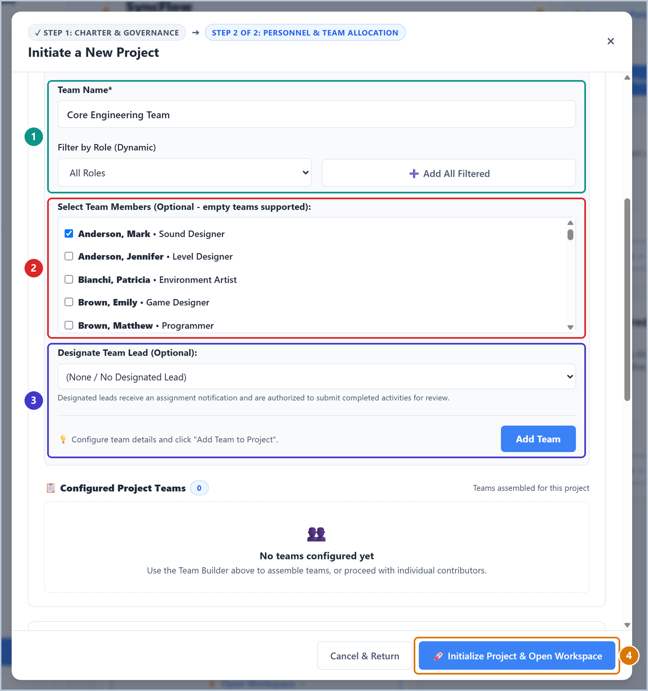
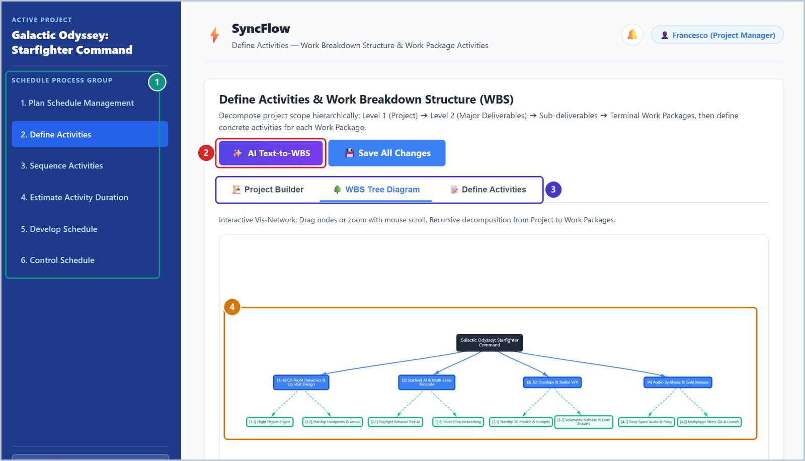
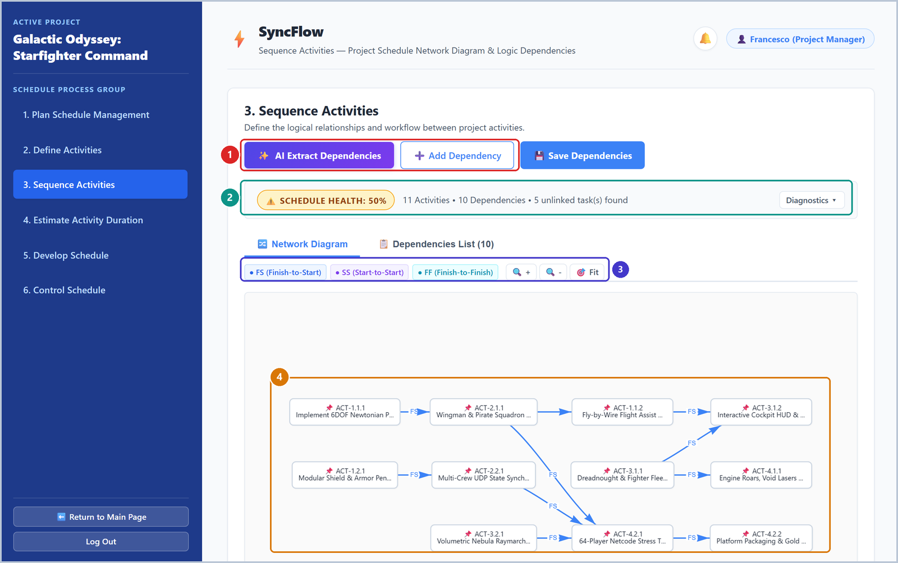
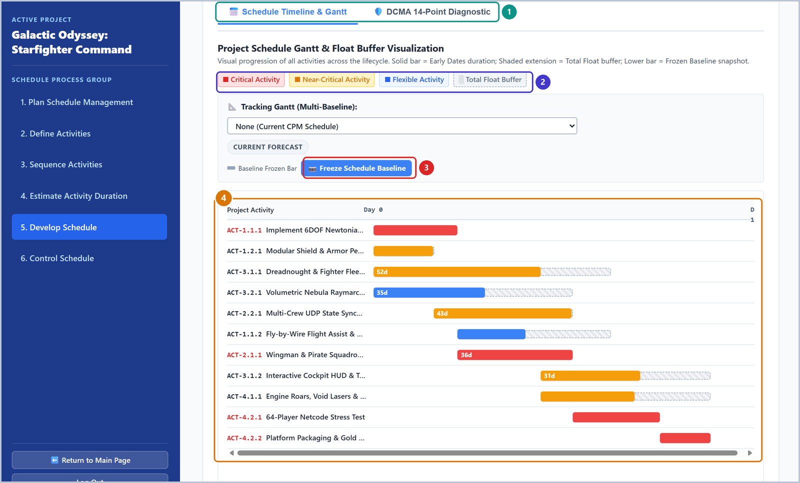
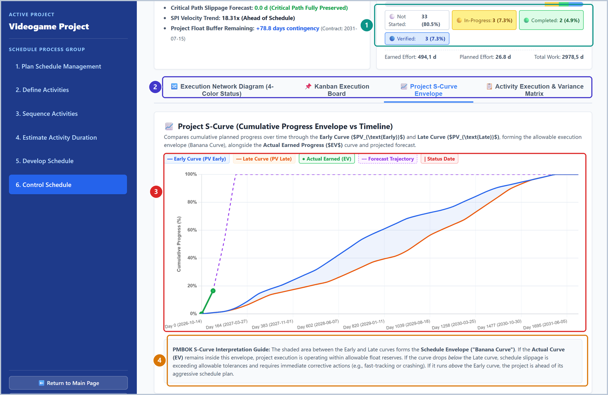
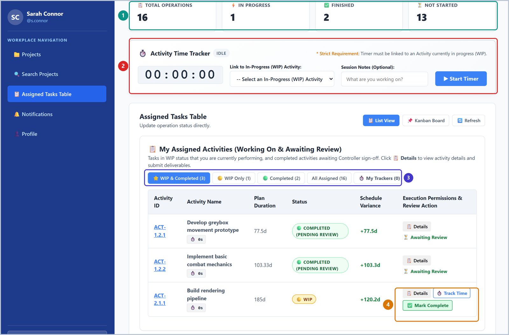

# SyncFlow
## Project Overview
**SyncFlow** is a full-stack, web-based **Project Schedule Management and Operational Control** platform modeled around the six schedule management processes of PMI's **PMBOK&reg; Guide (Chapter 6)**: *Plan Schedule Management*, *Define Activities*, *Sequence Activities*, *Estimate Activity Durations*, *Develop Schedule*, and *Control Schedule*.

> **UNIVERSITY OF PISA — DEPARTMENT OF INFORMATION ENGINEERING**  
> *Master's Degree in Artificial Intelligence and Data Engineering*  
> **Course:** Business and Project Management | **Academic Year:** 2025 / 2026  
> **Author:** Francesco Panattoni

Designed to bridge the gap between lightweight task boards and complex enterprise desktop suites, SyncFlow combines deterministic Operations Research scheduling engines, time-based Earned Value monitoring, and role-separated web workspaces inside a zero-cost, Dockerized open-source stack:
- **Deterministic Scheduling & Risk Analytics**: Kahn's topological sort and three-color DFS cycle detection, Critical Path Method (CPM) forward/backward passes supporting `FS`/`SS`/`FF`/`SF` relationships with lags, Total/Free/Project Float computation, interactive Activity-on-Node (AON) and Activity-on-Arrow (AOA) graphs, and PERT Three-Point Beta probability simulations.
- **Schedule Quality & Live Execution Control**: Automated **DCMA 14-Point Schedule Quality Assessment** (`A`–`F` scoring with culprit drill-down), baseline snapshots, Earned Value Management (EVM) KPIs (`PV`, `EV`, `SV`, `SPI`, `EAC_t`) with S-Curve **Banana Envelope** charts, stopwatch time logging, and Controller verification workflows.
- **Schema-Enforced AI Assistants**: Optional Google Gemini Flash NLP helpers (`Text-to-WBS`, `PERT Duration Estimation`, and `Dependency Extraction`) validated strictly via Pydantic schemas and cycle checks before saving.
- **Multi-Container Stack**: Powered by **FastAPI** (Python 3.12), **MongoDB 7.0** with strict `$jsonSchema` validation, **Vanilla ES6 JavaScript / HTML5 / CSS3** (`vis-network` and `Chart.js`), and **Docker Compose**.

## Installation Guide
Follow these step-by-step instructions to install and run SyncFlow from scratch on your local machine.

### Prerequisites
Ensure the following tools are installed before starting:

1. **Git** to clone the repository.
2. **Docker Desktop** (Windows/macOS) or **Docker Engine + Docker Compose v2** (`docker compose`) on Linux. Make sure the Docker daemon is running before launching SyncFlow.
3. **Python 3.10+** (recommended: Python 3.12) with `pip` if you plan to use the automated launcher (`app.py`, `start.bat`, `start.ps1`) or populate sample data with `populate_db.py`.
4. *(Optional)* A **Google Gemini API Key** (free tier via [Google AI Studio](https://aistudio.google.com/app/apikey)) if you want to use the AI-assisted WBS, duration estimation, or dependency extraction features. You can either place it in the environment file or paste it directly inside the SyncFlow web interface at runtime.

### Step 1: Clone the Repository
Open a terminal (Command Prompt, PowerShell, or Bash) and clone the project:

```bash
git clone https://github.com/Tenshin000/SyncFlow.git
cd SyncFlow
```

### Step 2: Review Environment Configuration
Environment defaults are pre-configured in [`docker/public.env`](docker/public.env) (database credentials, ports `8501`, `8000`, `8081`, `27017`, and LLM settings).

- For standard local usage, **no edits are required**. (If `docker/public.env` is absent, `app.py` generates one with working defaults automatically.)
- *(Optional)* To pre-configure a server-side Gemini API key, open `docker/public.env` and replace the placeholder value:

```env
GEMINI_API_KEY=your_actual_gemini_api_key_here
```

### Step 3: Build and Start the Application
You can launch SyncFlow using either the **Automated Python Launcher** (recommended) or **Docker Compose directly**.

#### Option A: Automated Launcher (Recommended)
`app.py` checks and installs host Python dependencies listed in `requirements.txt`, verifies that Docker is running, builds and starts all four containers (`syncflow-mongodb`, `syncflow-backend`, `syncflow-frontend`, `syncflow-mongo-express`), waits for health checks, and opens the login page in your default browser.

- **Windows (Command Prompt / Explorer)**:
  Double-click `start.bat` or run:
  ```bat
  python app.py
  ```
- **Windows (PowerShell)**:
  ```powershell
  .\start.ps1
  ```
- **Linux / macOS**:
  ```bash
  python3 app.py
  ```

Optional launcher flags supported by `app.py`, `start.bat`, and `start.ps1`:

- `--populate` (or `-p`): Starts containers and imports sample projects, users, and notifications into MongoDB.
- `--clean`: Clears existing collections and re-imports sample data from scratch.
- `--build` (or `-b`): Forces a fresh Docker image build before starting.

Example:

```bash
python app.py --populate --build
```

#### Option B: Direct Docker Compose Scripts (No Host Python Needed for Runtime)
If you prefer managing containers directly with Docker:

- **Windows (PowerShell)**:
  ```powershell
  .\docker\compose.ps1 up
  ```
- **Linux / macOS**:
  ```bash
  chmod +x docker/compose.sh
  ./docker/compose.sh up
  ```
- **Manual `docker compose` CLI (any OS, from the repository root)**:
  ```bash
  docker compose -p syncflow --env-file docker/public.env -f docker/docker-compose.yml up --build -d
  ```

### Step 4: Initialize and Seed the Database (Optional)
On first startup, MongoDB automatically runs `docker/mongo-init/01-init-database.js`, creating the `syncflow_db` collections (`users`, `projects`, `teams`, `notifications`), `$jsonSchema` validators, and indexes while leaving collections **empty by default**.

- **Start with an empty database**: Open `http://localhost:8501/signup.html` and click **Create an Account** to register a Project Manager (`Yes` to the Project Manager prompt) or Team Member account.
- **Load sample demonstration data**: Ensure host Python packages are installed (`pip install -r requirements.txt`) and run:
  ```bash
  python populate_db.py
  ```
  To reset all collections to the clean sample dataset at any time, run:
  ```bash
  python populate_db.py --clean
  ```
  Once populated, you can inspect sample users in `docker/mongo-init/users.json` (for example, Project Manager accounts `f.panattoni2` or `a.vance` with sample password `Mhanz0_0`).

### Step 5: Verify Running Services and Access the UI
Once containers are healthy (`docker compose -p syncflow ps`), access SyncFlow at:

| Service | URL | Notes / Default Credentials |
| :--- | :--- | :--- |
| **SyncFlow Web Application** | `http://localhost:8501/login.html` | Sign-in portal (`http://localhost:8501` redirects automatically). |
| **FastAPI REST API & Swagger UI** | `http://localhost:8000/docs` | Health probe available at `http://localhost:8000/syncflow/health`. |
| **Mongo Express (Admin GUI)** | `http://localhost:8081` | Web UI for inspecting `syncflow_db` (default login: `admin` / `admin`). |
| **MongoDB Server** | `localhost:27017` | Database `syncflow_db` (default root: `syncflow_admin` / `syncflow_password123`). |

### Step 6: Stopping, Logs, and Cleanup
Run these commands from the repository root (or inside `docker/` for the helper scripts):

- **Check container status**:
  ```bash
  docker compose -p syncflow --env-file docker/public.env -f docker/docker-compose.yml ps
  ```
- **Follow live logs**:
  ```bash
  docker compose -p syncflow --env-file docker/public.env -f docker/docker-compose.yml logs -f
  ```
- **Stop containers (preserve database data)**:
  ```bash
  docker compose -p syncflow --env-file docker/public.env -f docker/docker-compose.yml down
  ```
  *(Or run `.\docker\compose.ps1 down` / `./docker/compose.sh down`.)*
- **Stop containers and remove persistent database volumes**:
  ```bash
  docker compose -p syncflow --env-file docker/public.env -f docker/docker-compose.yml down -v
  ```
  *(Or run `.\docker\compose.ps1 clean` / `./docker/compose.sh clean`.)*


## Documentation
### Chapter 1: Introduction
<u>***SyncFlow***</u> is a full-stack, web-based **Project Schedule Management and Operational Control platform** built around the six core processes of the Project Management Institute's **PMBOK&reg; Guide**: *Plan Schedule Management*, *Define Activities*, *Sequence Activities*, *Estimate Activity Durations*, *Develop Schedule*, and *Control Schedule*. Designed as a *shared, role-based web workspace*, it brings formal scheduling mathematics, day-to-day task tracking, and Natural Language Processing together inside a **zero-cost open-source stack**.

*SyncFlow* was created to fix a practical gap in project management software, one that becomes especially visible in technical fields like software engineering, video game development, building construction, or design of laboratory equipment, in short any project where activities are highly interdependent. In practice, teams usually have to settle for tools at one of two extremes. **Lightweight task boards** like *Trello* and *Asana* make daily coordination easy, yet offer little in the way of **Operations Research**: they cannot catch dependency loops, compute *Critical Path Method (CPM)* dates and float margins, or estimate *probabilistic schedule risk*. Conversely, **enterprise desktop suites** like *Microsoft Project* and *Oracle Primavera P6* support formal scheduling calculations, but come with steep learning curves, high licensing fees, *desktop-bound workflows* kept away from frontline contributors, and no built-in language tools to help draft an initial plan.

SyncFlow tackles both sides of this problem with a **dual-engine web architecture** pairing exact scheduling algorithms with **human-in-the-loop Natural Language Processing**. At the core, a deterministic Python engine runs **topological sorting**, **cycle detection**, **CPM** forward and backward passes, **Three-Point PERT** probability estimates, **Earned Value Management** (**EVM**) S-Curves, and automated **14-point schedule audits** based on Defense Contract Management Agency (**DCMA**) criteria. Alongside this math engine, an NLP module powered by **Google Gemini Flash** speeds up initial drafting by turning plain-text scope documents into **Work Breakdown Structures** (**WBS**), proposing PERT duration ranges, and extracting *precedence relationships* from workflow descriptions. The application is primarily designed for Project Managers, while other users (Project Members) have more freedom, but are provided with a more restricted set of functionalities.

Just as importantly, the platform keeps schedule plans connected to actual work through **separate, synchronized interfaces** for different roles. **Project Managers** set up *governance policies*, *working calendars*, *dependency networks*, and *baselines*, while **Team Members** work from a focused *task agenda* with **live stopwatch timers** and **deliverable evidence submissions**. Whenever a contributor logs work hours or finishes a verified activity, project-wide Earned Value metrics and critical path buffers update in **real time**, keeping the schedule grounded in real progress rather than manual estimates.


### Chapter 2: Project Planning and Management
#### 2.1 The Triple Constraint Governance Model
Developing a scheduling platform is a practical test case for applying the same project management principles that the software itself implements. To keep engineering effort focused and avoid uncontrolled feature growth, planning followed the classical **Triple Constraint Model** (the Project Management Triangle), shown in the figure below. In this framework, **Scope**, **Time**, and **Budget** act as coupled constraints that directly govern overall deliverable **Quality**: whenever one side is held fixed, the others must be balanced carefully so reliability does not degrade.



- **Project Scope**: Scope was defined at the outset through a structured requirements review bounded around the six scheduling processes of PMBOK&reg; Chapter 6. Every proposed feature was checked against that core lifecycle, resulting in a containerized web architecture, schema-validated MongoDB storage, deterministic CPM/PERT/EVM engines, a 14-point DCMA audit, contributor time-tracking and controller review workflows, and *Google Gemini Flash* NLP helpers.
- **Budget**: Financial expenditure was fixed at **virtually zero (€0)**. Working without paid SaaS licenses or commercial enterprise software required relying entirely on open-source tooling (FastAPI, MongoDB Community Edition, Docker Compose, Vanilla JavaScript, `vis-network`, and `Chart.js`) together with free-tier Gemini Flash API quotas, trading capital spending for deliberate system design.
- **Time**: Execution spanned a seven-week, 53-day calendar window from September 21 to November 13, divided across architecture design, database setup, algorithmic implementation, UI refactoring, integration testing, documentation, and final vendor analysis.
- **Quality**: Holding cost at zero and keeping scope sharply defined focused the entire seven-week time budget on internal craftsmanship and verification. This discipline made room for essential mid-project corrections, replacing a sluggish Streamlit prototype with JavaScript modules and realigning the WBS structure with PMBOK's 100% rule, alongside strict MongoDB `$jsonSchema` rules, in-memory LRU caching, and edge-case validation across schedules and APIs.

In short, fixing the budget at €0 and drawing a clear boundary around schedule management allowed available time to go into iterative refactoring, mathematical verification, and testing whenever setbacks arose, turning tight constraints into higher final software quality.

#### 2.2 Chronological Development Schedule and Execution
Development progressed iteratively across the 53-day window, absorbing planned rest days, a multi-day interruption in late September, and several technical course corrections along the way: replacing an early Streamlit prototype with plain HTML/CSS/JavaScript (despite its faster development process, Streamlit's frontend proved unsatisfactory), re-aligning the WBS model with PMBOK's 100% rule (initially I didn't quite understand how a WBS works), adding the 14-point DCMA audit, and recovering from local Git repository corruption (I had issues with Git and a corrupted commit). The table below records the full chronological milestone log.

| Date / Period | Milestone / Domain | Key Deliverables & Engineering Activities |
| :--- | :--- | :--- |
| Sep 21–24 | Ideation & System Design | Requirements analysis, Database and Backend design, Frontend draft, PMBOK 6 mapping. |
| Sep 25–29 | Unforeseen Events (*Force Majeure*) | Work paused due to external circumstances. |
| Sep 30 | DB Schema & Docker Setup | MongoDB `$jsonSchema` specifications, multi-container `docker-compose` topology. |
| Oct 1–3 | Authentication & DB Seeding | Salted Bcrypt hashing, session tokens, Extended JSON/BSON data seeding. |
| Oct 4 | Scheduled Rest | Time off. |
| Oct 5–8 | UI Prototype & Architectural Migration | Streamlit prototype discarded and migrated to Vanilla JS/HTML5/CSS. |
| Oct 9 | PM Workspace Architecture | Component modularization, unified navigation shell, responsive UI layout. |
| Oct 10 | Plan Schedule Management (6.1) | Process 6.1 dashboard, project charter configuration, working calendar setup. |
| Oct 11 | Scheduled Rest | Time off. |
| Oct 12 | Project Creation Page | Two-Stage Creation Process, Single vs. Multi-Team & Open vs. Approval governance. |
| Oct 13 | Define Activities Dashboard (6.2) | Process 6.2 dashboard, Work Package decomposition, Vis-Network WBS tree. |
| Oct 14 | Activity Sequencing Inception (6.3) | PDM graph data structures, node models, dependency link abstractions. |
| Oct 15 | WBS Review & Concept Realignment | Conceptual refactoring aligning activities with terminal WBS packages (PMBOK 100% rule). |
| Oct 16–17 | Sequencing Dashboard (6.3) | Interactive PDM canvas, FS/SS/FF/SF dependencies, lead/lag adjustment, bug fixes. |
| Oct 18 | Scheduled Rest | Time off. |
| Oct 19–22 | Duration Estimation & PERT (6.4) | DFS recursion cycle detection, Three-Point Beta math, target probability simulator. |
| Oct 23 | Schedule Dashboard (6.5) | CPM forward/backward passes, Total/Free Float, AON/AOA graphs, Gantt chart. |
| Oct 24 | Schedule Control Dashboard (6.6) | 4-tier execution states, Earned Value KPIs, S-Curve Banana Envelope tracking. |
| Oct 25 | Scheduled Rest | Time off. |
| Oct 26 | Testing & Bug Fixes | Edge-case mathematical verification, zero-float validation, cache invalidation. |
| Oct 27 | Automated DCMA 14-Point Diagnostic | Defense-grade schedule health audit engine evaluating all 14 DCMA standards. |
| Oct 28 | Team Member Workspace | Contributor workspace, assigned operational agenda, execution Kanban board. |
| Oct 29 | Notification & Subscription System | Multi-recipient notifications, join request approval, Controller review alerts. |
| Oct 30 | Gemini AI & NLP Engine Integration | Text-to-WBS generation, PERT duration estimation, AI dependency extraction. |
| Oct 31 – Nov 1 | Scheduled Rest | Time off (All Saints / All Souls break). |
| Nov 2 | Testing & Bug Fixes | AI prompt hardening, JSON schema parsing validation, edge-case testing. |
| Nov 3–4 | Trello-Style Stopwatch Timers | Live activity timer widget, server-side duration logging, project time log history. |
| Nov 5 | NLP Engine Bug Fixes | Gemini model fallback hardening, external API rate limit resilience. |
| Nov 6 | Git Repository Recovery | Diagnosis and resolution of local Git file corruption. |
| Nov 7 | Final Testing & Quality Assurance | End-to-end regression testing, UI polish, cross-browser responsiveness validation. |
| Nov 9 | Project Completion | Final release verification, documentation readiness, and project sign-off. |
| Nov 10–11 | Documentation | Project documentation has been prepared. |
| Nov 12–13 | Vendor Analysis | The project's Vendor Analysis has been prepared. |

*Chronological Development Schedule and Milestone Execution Ledger (Sep 21 – Nov 13).*


### Chapter 3: Theoretical Foundations
#### 3.1 The Schedule Management Lifecycle
*SyncFlow* pairs classical Operations Research (OR) techniques with the scheduling framework introduced in the PMBOK&reg; Guide. Rather than tracking tasks with informal dates and spreadsheets, the backend treats schedules as formal graphs and statistical models so network validity, duration uncertainty, execution variance, and schedule quality can all be checked automatically.

In this model, turning high-level project scope into a monitored schedule follows six sequential stages:

1. **Plan Schedule Management**: Defining working weekdays, daily shift hours, holidays, and team responsibility rules before building any schedule;
2. **Define Activities**: Breaking down terminal Work Breakdown Structure (WBS) work packages into discrete, schedulable activities;
3. **Sequence Activities**: Recording technical precedence links among those activities using the Precedence Diagramming Method (PDM);
4. **Estimate Activity Durations**: Quantifying expected effort and uncertainty through Three-Point parameters under a Beta probability model;
5. **Develop Schedule**: Computing early and late execution bounds, float margins, and critical paths across the network before freezing an approved baseline;
6. **Control Schedule**: Monitoring ongoing delivery against the baseline using Earned Value metrics, execution states, and deliverable sign-off.

#### 3.2 Critical Path Method and Precedence Networks
##### 3.2.1 Topological Sorting and Cycle Detection
The analytical scheduling engine models the project as a directed acyclic graph (DAG) $G = (V, E)$, where $V = \{v_1, \dots, v_n\}$ represents activities and $E \subseteq V \times V$ represents precedence constraints. Each edge $e = (u, v) \in E$ denotes a logical constraint where $u$ precedes $v$, qualified by dependency type $\text{Type}(e) \in \{\text{FS}, \text{SS}, \text{FF}, \text{SF}\}$ and lead/lag $L_{u,v} \in \mathbb{R}$.

Before scheduling passes execute, graph $G$ is verified as acyclic via combined Kahn's in-degree evaluation and Depth-First Search (DFS) three-color traversal ($\textit{White} \to \textit{Gray} \to \textit{Black}$). If a back-edge to a node in the active recursion stack (*Gray*) is detected, a cyclic deadlock is flagged:

$$
\text{Cycle}(G) \iff \exists (u, v) \in E \text{ such that } \text{Color}(v) = \textit{Gray}
$$

A topological ordering $\tau: V \to \{1, \dots, |V|\}$ ensures that for every directed edge $(u, v) \in E$, $\tau(u) < \tau(v)$.

##### 3.2.2 Forward and Backward Pass Calculations
Given a topologically sorted sequence and calendar working durations $d_v \ge 0$, the **Forward Pass** computes Early Start ($ES$) and Early Finish ($EF$):

$$
ES_v = \max_{u \in \text{pred}(v)} (\text{Candidate}_{u,v}) \qquad \qquad ES_{\text{root}} = 0 \qquad \qquad EF_v = ES_v + d_v
$$

Where the predecessor constraint candidate value $\text{Candidate}_{u,v}$ is defined by relationship type:

$$
\text{Candidate}_{u,v} = \begin{cases} EF_u + L_{u,v} \quad (\text{FS}) & \mid \quad ES_u + L_{u,v} \quad (\text{SS}) \\ EF_u + L_{u,v} - d_v \quad (\text{FF}) & \mid \quad ES_u + L_{u,v} - d_v \quad (\text{SF}) \end{cases}
$$

Total project duration is $T_{\text{project}} = \max_{v \in V} (EF_v)$. The **Backward Pass** propagates from terminal nodes, computing Late Finish ($LF$) and Late Start ($LS$):

$$
LF_u = \min_{v \in \text{succ}(u)} (\text{Required}_{u,v}) \qquad \qquad LF_{\text{terminal}} = T_{\text{project}} \qquad \qquad LS_u = LF_u - d_u
$$

$$
\text{Required}_{u,v} = \begin{cases} LS_v - L_{u,v} \quad (\text{FS}) & \mid \quad LS_v - L_{u,v} + d_u \quad (\text{SS}) \\ LF_v - L_{u,v} \quad (\text{FF}) & \mid \quad LF_v - L_{u,v} + d_u \quad (\text{SF}) \end{cases}
$$

##### 3.2.3 Float Formulation and Path Criticality
For each activity $i \in V$, the platform computes **Total Float** ($TF$) and **Free Float** ($FF$):

$$
TF_i = LS_i - ES_i = LF_i - EF_i \qquad \qquad FF_i = \min_{j \in \text{succ}(i)} \left( ES_j - L_{i,j} \right) - EF_i
$$

An activity is defined as **Critical** if its Total Float is zero within numerical tolerance:

$$
\text{Critical}(i) \iff |TF_i| \le \varepsilon \quad (\varepsilon = 10^{-4} \text{ days})
$$

The **Critical Path** is the contiguous sequence of critical activities from project start to finish. Any delay along this chain propagates day-for-day to the final delivery date.

#### 3.3 PERT Statistical Risk Engine and Probability Modeling
Single-point duration estimates rarely hold up in practice when tasks carry technical uncertainty. *SyncFlow* implements the Program Evaluation and Review Technique (PERT), modeling each task duration as a Beta random variable bounded by three estimates: Optimistic ($a_i$), Most Likely ($m_i$), and Pessimistic ($b_i$), with $0 \le a_i \le m_i \le b_i$. From these parameters, the mean expected duration ($t_{e,i}$), standard deviation ($\sigma_i$), and variance ($\sigma_i^2$) follow directly:

$$
t_{e,i} = \frac{a_i + 4m_i + b_i}{6} \qquad \qquad \sigma_i = \frac{b_i - a_i}{6} \qquad \qquad \sigma_i^2 = \left(\frac{b_i - a_i}{6}\right)^2
$$

Assuming activity durations along Critical Path $CP \subseteq V$ vary independently, the Central Limit Theorem allows total critical path duration to be approximated by a normal distribution:

$$
T_{CP} \sim \mathcal{N}(\mu_{CP}, \sigma_{CP}^2) \qquad \qquad \mu_{CP} = \sum_{i \in CP} t_{e,i} \qquad \qquad \sigma_{CP} = \sqrt{\sum_{i \in CP} \sigma_i^2}
$$

For any target deadline $T_{\text{target}}$, the standardized deviate $Z = \frac{T_{\text{target}} - \mu_{CP}}{\sigma_{CP}}$ gives the probability of finishing on or before that date:

$$
P(T_{CP} \le T_{\text{target}}) = \Phi(Z) = \frac{1}{2} \left[ 1 + \text{erf}\left(\frac{Z}{\sqrt{2}}\right) \right]
$$

$\text{erf}(x)=\frac{2}{\sqrt{\pi }}\int _{0}^{x}e^{-t^{2}}\,dt$

#### 3.4 Earned Value Management and the S-Curve Banana Envelope
During execution, *SyncFlow* tracks schedule performance using time-based Earned Value Management (EVM) rather than relying solely on subjective status percentages. Over $t$ elapsed working days, progress is measured with five standard metrics:

- **Planned Value**: $PV(t) = \sum_{i \in V} d_i \cdot \text{PlannedProgress\%}_i(t)$
- **Earned Value**: $EV(t) = \sum_{i \in V} d_i \cdot (\text{ActualProgress\%}_i / 100)$
- **Schedule Variance**: $SV = EV - PV$
- **Schedule Performance Index**: $SPI = \frac{EV}{PV}$
- **Time Estimate at Completion**: $EAC_t = \frac{\text{Planned Duration}}{SPI}$

Non-critical activities have room to slide within their available float without delaying the final deadline, so *SyncFlow* plots the **Banana Envelope** between two boundary curves:

1. **Early S-Curve ($PV_{\text{Early}}$)**: Cumulative progress when every activity runs as early as possible ($ES$).
2. **Late S-Curve ($PV_{\text{Late}}$)**: Cumulative progress when every activity is shifted as late as possible ($LS$) without moving the project finish date.

The region between $PV_{\text{Early}}$ and $PV_{\text{Late}}$ forms the "Banana Envelope". As long as Earned Value ($EV$) stays inside this band, minor delays can still be absorbed by float. Dropping below $PV_{\text{Late}}$ means the final deadline is at risk unless schedule compression is applied.

#### 3.5 DCMA 14-Point Schedule Quality Assessment
Before locking a baseline, *SyncFlow* also runs an automated quality audit modeled on the **Defense Contract Management Agency (DCMA)** 14-Point Assessment. Each check evaluates structural or temporal discipline directly from the activity graph, as summarized in the table below.

| # | DCMA Metric | Mathematical Definition & Evaluation Rule | Threshold |
| :---: | :--- | :--- | :---: |
| 1 | Logic (Open Ends) | $\frac{\lvert \{i \in V \mid \text{in-deg}(i)=0 \land ES_i>0\} \cup \{i \in V \mid \text{out-deg}(i)=0 \land EF_i < \max EF\} \rvert}{\lvert V \rvert}$ | $\le 5\%$ |
| 2 | Leads (Negative Lags) | $\frac{\lvert \{e \in E \mid L_e < 0\} \rvert}{\lvert E \rvert}$ | $= 0\%$ |
| 3 | Lags (Positive Lags) | $\frac{\lvert \{e \in E \mid L_e > 0\} \rvert}{\lvert E \rvert}$ | $\le 5\%$ |
| 4 | Relationship Types | $\frac{\lvert \{e \in E \mid \text{Type}(e) = \text{FS}\} \rvert}{\lvert E \rvert}$ | $\ge 90\%$ |
| 5 | Hard Constraints | Percentage of activities constrained by rigid calendar date overrides | $\le 5\%$ |
| 6 | High Float | $\frac{\lvert \{i \in V \mid TF_i > 44 \text{ days}\} \rvert}{\lvert V \rvert}$ | $\le 5\%$ |
| 7 | Negative Float | $\frac{\lvert \{i \in V \mid TF_i < -0.05 \text{ days}\} \rvert}{\lvert V \rvert}$ | $= 0\%$ |
| 8 | High Duration | $\frac{\lvert \{i \in V \mid d_i > 44 \text{ days} \land \neg \text{Milestone}_i\} \rvert}{\lvert V \rvert}$ | $\le 5\%$ |
| 9 | Invalid Dates | $\frac{\lvert \{i \in V \mid EF_i < ES_i\} \rvert}{\lvert V \rvert}$ | $= 0\%$ |
| 10 | Resource Loaded | $\frac{\lvert \{i \in V \mid \text{Assignees}(i) \ne \emptyset \lor \text{Milestone}_i\} \rvert}{\lvert V \rvert}$ | $\ge 95\%$ |
| 11 | Missed Tasks | $\frac{\lvert \{i \in V \mid \text{Status}_i \ne \text{Done} \land EF_i < t_{\text{status}}\} \rvert}{\lvert V \rvert}$ | $\le 5\%$ |
| 12 | Critical Path Continuity | Verification that a contiguous chain of critical activities spans start to finish | Pass |
| 13 | Critical Float Index (CFIX) | $\text{CFIX} = \frac{T_{\text{project}} + PF}{T_{\text{project}}}$ | $\ge 0.95$ |
| 14 | Schedule Index (SPI) | Earned Value velocity ratio $SPI = \frac{EV}{PV}$ | $0.95 \le SPI$ |

*Mathematical Formulations of the Automated DCMA 14-Point Quality Assessment.*

The diagnostic calculates compliance percentages, assigns an aggregate grade (A–F), and flags specific culprit activities in the interface to enable rapid remediation before baseline formalization.


### Chapter 4: Implementation
#### 4.1 System Architecture and Container Topology
*SyncFlow* is split into a multi-container web application managed with **Docker Compose**. Database persistence, backend computation, and static frontend delivery run in separate containers connected over an internal virtual network (`syncflow-network`). The diagram below shows the overall layout and data flow.



*SyncFlow Multi-Container System Architecture and Service Topology.*

Three services are defined in `docker-compose.yml`:

- **Database Container (`syncflow-db`)**: Runs MongoDB Community Edition (v7.0) on internal port `27017`, persisting data on a named Docker volume (`mongo_data`) across container restarts. Container health is checked with a ping command (`mongosh --eval "db.adminCommand('ping')"`);
- **Backend Container (`syncflow-backend`)**: Runs Python 3.12 with Uvicorn and FastAPI on port `8000`. It mounts the backend source directory, loads database URIs and Gemini API keys from the environment, and opens the MongoDB connection pool at startup;
- **Frontend Container (`syncflow-frontend`)**: Serves static HTML5, CSS3, and ES6 JavaScript modules on port `8501` using Python's built-in `http.server` module from the same slim image as the backend. Isolating static file delivery in its own container separates lightweight web asset serving from FastAPI's heavier schedule computations and AI calls on port `8000`, keeps page delivery running independently if the API reloads, and avoids any Node.js or bundler pipeline so plain file updates go live on browser refresh.

#### 4.2 Database Layer and Data Integrity
Persistence is handled through MongoDB, pairing flexible nested documents with server-side JSON Schema rules so malformed payloads cannot be written silently.

Data is stored across four core **Document Collections**:

1. **`users`**: Account profiles, Bcrypt password hashes, administrative flags, and contributor specialty roles;
2. **`projects`**: The central project document storing metadata and governance rules, working `calendar_settings`, nested `wbs` hierarchies, embedded `activities` (PDM links, PERT parameters, 4-tier statuses, checklists, and active timer/log entries), and saved `baselines`;
3. **`teams`**: Reusable team templates created by Project Managers for import across projects;
4. **`notifications`**: System alerts, controller inspection notices, and interactive join requests.

Both `users` and `projects` enforce strict MongoDB `$jsonSchema` rules (`validationLevel="strict"`) covering required fields, BSON types, and format constraints. Concurrent updates to nested activities (progress percentages, checklists, and stopwatch logs) run atomically with MongoDB `arrayFilters` and the `$[act]` positional operator:

```python
db.projects.update_one(
    {"_id": ObjectId(project_id)},
    {"$set": {
        "activities.$[act].status": new_status,
        "activities.$[act].actual_progress": progress
    }},
    array_filters=[{"act.activity_id": activity_id}]
)
```

Updating a single matched element in place avoids whole-document overwrites when multiple contributors work on different activities at the same time.

#### 4.3 Backend Architecture and Computation Engine
The backend is written in **FastAPI** (Python 3.12) and divided into domain routers mounted under `/syncflow`. Requests and responses are checked with **Pydantic** models, passwords are salted and hashed using **Bcrypt** (`rounds=12`), and route handlers filter queries by validated user, manager, and project identifiers.

Recomputing CPM passes, PERT probabilities, and EVM S-curves on every read request would add unnecessary database and CPU work. Instead, *SyncFlow* uses a thread-safe in-memory LRU cache backed by `collections.OrderedDict` and a reentrant `threading.Lock`:

- **Cache Key Formulation**: Each key combines the project ID, document update timestamp, and query options: $\text{Key} =$ `f"{project_id}:{updated_at}:{cpm_flags}"`;
- **In-Memory Reuse**: Repeated schedule and EVM queries read directly in $O(1)$ time without hitting MongoDB;
- **Write Invalidation**: Every write route that edits activities, links, or calendar settings calls `invalidate_project_schedule_cache(project_id)` so stale results are dropped immediately.

#### 4.4 RESTful API Architecture and Endpoints
*SyncFlow* exposes 55 RESTful endpoints distributed across six domain routers (`user`, `projects`, `teams`, `notifications`, `portfolio`, and `nlp`). Every endpoint validates incoming JSON payloads and query parameters through Pydantic models, returns standardized HTTP status codes (`200`, `201`, `400`, `404`), and triggers automatic schedule cache invalidation whenever underlying schedule state is mutated. To clearly distinguish the role of each service, the platform's API surface is organized below by functional domain.

##### 4.4.1 User Management and Authentication APIs
User registration, credential verification, and service readiness probes are handled by the core authentication router mounted at `/syncflow/user` alongside the root health endpoint. The table below documents each user and system health API.

| Verb | Endpoint Path | Functional Purpose & Behavior |
| :--- | :--- | :--- |
| **`POST`** | `/syncflow/user/signup` | Registers a new account, validates password match and role assignment, and hashes credentials via Bcrypt (`rounds=12`). |
| **`POST`** | `/syncflow/user/login` | Authenticates username or normalized email against the stored Bcrypt digest and returns the user profile. |
| **`GET`** | `/syncflow/user` | Lists all registered workspace users to populate team selection and personnel rosters. |
| **`GET`** | `/syncflow/user/{user_id}` | Fetches a single user record resolved by MongoDB `ObjectId` or normalized username. |
| **`GET`** | `/syncflow/user/{user_id}/profile` | Returns formatted account metadata consumed by self-service profile views. |
| **`PUT`** | `/syncflow/user/{user_id}` | Updates personal profile details while enforcing global uniqueness across usernames and emails. |
| **`DELETE`** | `/syncflow/user/{user_id}` | Removes a user account document from the `users` collection. |
| **`GET`** | `/syncflow/health` | Lightweight liveness diagnostic confirming backend availability with an ISO UTC timestamp. |

*User Account, Authentication, and System Health Endpoints.*

##### 4.4.2 Project Lifecycle APIs
Project creation, organizational governance, member discovery, and formal launch transitions are managed under `/syncflow/projects`. These routes cover project charter configuration, personnel assignments across single- and multi-team structures, Open versus Approval enrollment flows, and cross-project historical completion lookups. The table below summarizes the charter and project lifecycle endpoints.

| Verb | Endpoint Path | Functional Purpose & Behavior |
| :--- | :--- | :--- |
| **`GET`** | `/syncflow/projects` | Lists project summaries, optionally filtered by creator `pm_id` or participating `member_id`. |
| **`POST`** | `/syncflow/projects` | Creates a project charter with start date, Single/Multi-Team rules, Open/Approval policies, teams, and calendar. |
| **`GET`** | `/syncflow/projects/{project_id}` | Returns the complete project document including WBS, activities, dependencies, and baselines. |
| **`PUT`** | `/syncflow/projects/{project_id}/description` | Updates the project scope statement and description in the schedule governance view. |
| **`PUT`** | `/syncflow/projects/{project_id}/personnel` | Reassigns functional teams, Team Leads, unassigned specialists, and project Controllers. |
| **`GET`** | `/syncflow/projects/available/search` | Queries open or approval-gated projects by keyword and computes the user's join status. |
| **`POST`** | `/syncflow/projects/{project_id}/join` | Enrolls a contributor immediately on Open projects or emits a join request notification on Approval projects. |
| **`POST`** | `/syncflow/projects/{project_id}/kickoff` | Formally initiates project execution, transitioning lifecycle status from planning to active state. |
| **`GET`** | `/syncflow/projects/completed-activities` | Aggregates Controller-verified historical activities across projects for cross-project reference. |
| **`DELETE`** | `/syncflow/projects/{project_id}` | Deletes a project record from MongoDB and evicts any cached schedule artifacts. |

*Project Charter, Governance, Discovery, and Lifecycle Endpoints.*

##### 4.4.3 Schedule Planning, Sequencing, and Operations Research APIs
The core scheduling endpoints manage hierarchical Work Breakdown Structure assembly, precedence network validation, deterministic CPM/PERT calculation, baseline locking, and defense-grade quality auditing. Whenever structural or temporal data change, the backend automatically evicts stale entries from the LRU schedule cache. The table below details these endpoints.

| Verb | Endpoint Path | Functional Purpose & Behavior |
| :--- | :--- | :--- |
| **`PUT`** | `/syncflow/projects/{project_id}/wbs` | Replaces or updates the hierarchical WBS tree (Major Deliverables, Sub-deliverables, and Work Packages). |
| **`PUT`** | `/syncflow/projects/{project_id}/deliverables` | Compatibility route mapping legacy deliverable arrays onto the canonical nested `wbs` structure. |
| **`PUT`** | `/syncflow/projects/{project_id}/activities` | Persists discrete activities, milestones, PERT inputs, and resource assignees. |
| **`GET`** | `/syncflow/projects/{project_id}/schedule-health` | Inspects the activity graph for open ends, dangling activities, excessive lags, logic density, and cycles. |
| **`PUT`** | `/syncflow/projects/{project_id}/dependencies` | Updates directed PDM precedence links (`FS`, `SS`, `FF`, `SF`), rejecting negative lags and cyclic loops. |
| **`POST`** | `/syncflow/projects/{project_id}/schedule-settings` | Saves externally imposed deadlines, near-critical float thresholds, and default diagram mode (`aon`/`aoa`). |
| **`GET`** | `/syncflow/projects/{project_id}/schedule` | Executes cached CPM passes, computing early/late dates, Total/Free/Project Float, and AON/AOA graph payloads. |
| **`GET`** | `/syncflow/projects/{project_id}/pert-analysis` | Computes Critical Path expected duration ($\mu_{CP}$), variance ($\sigma_{CP}^2$), $Z$-score, and completion probability $\Phi(Z)$. |
| **`POST`** | `/syncflow/projects/{project_id}/baselines` | Freezes the calculated CPM schedule into the canonical Planned Baseline snapshot for variance tracking. |
| **`GET`** | `/syncflow/projects/{project_id}/baselines` | Retrieves stored Planned Baseline snapshots for planned-versus-actual schedule comparison. |
| **`DELETE`** | `/syncflow/projects/{project_id}/baselines/{baseline_id}` | Clears the saved baseline snapshot when major scope replanning is approved. |
| **`GET`** | `/syncflow/projects/{project_id}/schedule/dcma-quality` | Audits the schedule against all 14 DCMA metrics, returning compliance scores, grade (`A–F`), and culprits. |

*Work Breakdown, Precedence Sequencing, CPM/PERT Analytics, and Audit Endpoints.*

##### 4.4.4 Schedule Control, Live Time Tracking, and Enterprise APIs
Live execution monitoring, Earned Value tracking, and granular Trello-style stopwatch logging operate directly against nested activity records using atomic MongoDB updates. The table below details the schedule control and activity time-tracking endpoints.

| Verb | Endpoint Path | Functional Purpose & Behavior |
| :--- | :--- | :--- |
| **`GET`** | `/syncflow/projects/{project_id}/control-schedule` | Computes Earned Value KPIs ($PV$, $EV$, $SV$, $SPI$, $EAC_t$), status distributions, and S-Curve Banana Envelope points. |
| **`PUT`** | `/syncflow/projects/{project_id}/activities/{activity_id}/status` | Transitions execution state (Not Started, WIP, Completed, Verified), logs deliverable evidence, and records Controller sign-off. |
| **`POST`** | `/syncflow/projects/{project_id}/activities/seed-progress` | Initializes realistic benchmark progress across activities for simulation and testing scenarios. |
| **`POST`** | `/syncflow/projects/{project_id}/activities/{activity_id}/timer/start` | Starts an active stopwatch session bound strictly to an activity currently in Work-in-Progress state. |
| **`POST`** | `/syncflow/projects/{project_id}/activities/{activity_id}/timer/stop` | Stops the active stopwatch, computes elapsed seconds, writes a persistent log, and emits state alerts if needed. |
| **`GET`** | `/syncflow/projects/{project_id}/activities/{activity_id}/time-logs` | Retrieves the full chronological timer history and cumulative duration recorded for one activity. |
| **`GET`** | `/syncflow/projects/{project_id}/time-logs/summary` | Summarizes total logged work hours across every project activity for executive time auditing. |
| **`PUT`** | `/syncflow/projects/{project_id}/activities/{activity_id}/time-logs/{log_id}` | Modifies elapsed duration or session notes on a user-created time log entry. |
| **`DELETE`** | `/syncflow/projects/{project_id}/activities/{activity_id}/time-logs/{log_id}` | Removes an erroneous time log entry and recalculates the activity's accumulated effort. |
| **`GET`** | `/syncflow/projects/{project_id}/my-time-logs` | Returns all work sessions logged by a single contributor across every activity in the project. |

*Schedule Control, Earned Value, and Activity Stopwatch Timer Endpoints.*

Cross-project administration, reusable organizational teams, portfolio analytics, and interactive alerts are exposed through dedicated routers (`/syncflow/teams`, `/syncflow/portfolio`, and `/syncflow/notifications`). The table below summarizes these enterprise coordination APIs.

| Verb | Endpoint Path | Functional Purpose & Behavior |
| :--- | :--- | :--- |
| **`GET`** | `/syncflow/teams` | Retrieves saved organizational team templates filtered optionally by creator `pm_id`. |
| **`POST`** | `/syncflow/teams` | Upserts a custom team template (name, roster IDs, and Team Lead) into the global library. |
| **`GET`** | `/syncflow/portfolio/dashboard` | Aggregates multi-project Earned Value KPIs ($PV$, $EV$, $SV$, $SPI$) and critical slippage indicators. |
| **`POST`** | `/syncflow/notifications` | Creates a targeted or project-wide notification entry in the `notifications` collection. |
| **`GET`** | `/syncflow/notifications` | Fetches notifications addressed to a `user_id`, with optional `project_id` scoping. |
| **`GET`** | `/syncflow/notifications/unread-count` | Returns the unread notification counter used to update navigation badges in real time. |
| **`PUT`** | `/syncflow/notifications/{notification_id}/read` | Appends the requesting user to the notification's `read_by` array. |
| **`PUT`** | `/syncflow/notifications/mark-all-read` | Marks all visible notifications for the user as read in a single batch operation. |
| **`POST`** | `/syncflow/notifications/{notification_id}/action` | Resolves interactive requests (such as approving or rejecting project join applications). |
| **`DELETE`** | `/syncflow/notifications/{notification_id}` | Soft-deletes a notification for the caller by recording their ID in `deleted_by`. |

*Reusable Teams Library, Executive Portfolio, and Notification Hub Endpoints.*

##### 4.4.5 Natural Language Processing and AI Service APIs
Natural Language Processing capabilities are exposed via the `/syncflow/nlp` and `/syncflow/projects/{project_id}/nlp` endpoints, turning unstructured scope descriptions and workflow prose into schema-validated project structures. The table below documents the NLP endpoints examined further in Chapter 5.

| Verb | Endpoint Path | Functional Purpose & Behavior |
| :--- | :--- | :--- |
| **`GET`** | `/syncflow/nlp/models` | Returns the strictly permitted Gemini Flash model identifiers configured by the backend. |
| **`POST`** | `/syncflow/nlp/verify-key` | Tests whether a user-supplied or environment API key authenticates cleanly with active models. |
| **`POST`** | `/syncflow/projects/{project_id}/nlp/text-to-wbs` | Parses unstructured project scope into a multi-tier WBS and PERT-initialized activities (`merge` or `replace`). |
| **`POST`** | `/syncflow/projects/{project_id}/nlp/estimate-durations` | Evaluates activity texts semantically to infer DCMA-compliant $(a, m, b)$ estimates and risk rationales. |
| **`POST`** | `/syncflow/projects/{project_id}/nlp/extract-dependencies` | Extracts directed PDM precedence links (`FS`, `SS`, `FF`, `SF`) and non-negative lags from narratives with cycle checks. |

*Natural Language Processing, Key Verification, and Schedule Extraction Endpoints.*

#### 4.5 Frontend Architecture and Data Visualizations
##### 4.5.1 Interactive Network Visualizations via Vis-Network
After moving away from the initial Streamlit prototype, the frontend was rebuilt in plain Vanilla JavaScript, HTML5, and custom CSS (`styles.css`). Keeping the client free of bundlers and heavy UI frameworks keeps pages fast to load and makes direct DOM updates straightforward during interactive graph edits.

*SyncFlow* uses the `vis-network` canvas library for three network diagrams:

1. **Hierarchical WBS Tree**: Top-down tree layout ($UD$) tracing the breakdown from the root project through Major Deliverables, sub-deliverables, and terminal Work Packages;
2. **Horizontal PDM Precedence Canvas**: Left-to-right directed graph ($LR$) color-coding dependency types: FS (Blue), SS (Purple), FF (Teal), and SF (Dashed amber);
3. **AON and AOA Network Graphs**: In the Develop Schedule Process view, the canvas switches between Activity-on-Node blocks (showing early/late dates and float values, with the Critical Path marked in red) and Activity-on-Arrow PERT event graphs with dual-moment circles and dashed dummy links.

##### 4.5.2 Earned Value S-Curve Visualization via Chart.js
In the **Control Schedule dashboard**, *SyncFlow* renders the time-based EVM S-Curve with `Chart.js`. The chart plots Early Planned Value ($PV_{\text{Early}}$) and Late Planned Value ($PV_{\text{Late}}$) to form the Banana Envelope alongside Actual Earned Value ($EV$) and the EAC projection, making schedule drift easy to spot at a glance.

##### 4.5.3 Client-Side Event Bus and State Synchronization
**Client state** is handled by modular dashboard scripts without external state libraries such as Redux. Page scripts listen for user interactions (node dragging, duration edits, modal submissions), send targeted REST calls, and refresh the DOM from the response. Users receive brief toast alerts after actions, while confirmation dialogs guard destructive steps such as baseline resets or activity deletions.


### Chapter 5: Generative AI and Natural Language Processing
#### 5.1 NLP Pipeline Architecture
Writing a complete project schedule by hand takes time, especially when starting from a rough brief, meeting notes, or a multi-page scope document. *SyncFlow* eases that setup step with a built-in **Natural Language Processing** (**NLP**) **pipeline** that turns everyday project descriptions into structured scheduling data. Rather than adding an open chat window that replies in free text, the platform uses language models strictly behind the scenes as structured parsers: they read human prose, pull out deliverables, durations, and activity relationships, and hand clean records to the math engine.

Because language-model outputs are probabilistic, raw text cannot go straight into CPM or PERT formulas. To keep results dependable, every AI request passes through a four-stage pipeline built across `backend/nlp/` (`prompts.py`, `schemas.py`, `gemini_client.py`) and the `routers/nlp.py` folders:

1. **Guided Prompt Building**: Dedicated prompt builders (`build_wbs_prompt`, `build_estimation_prompt`, and `build_dependency_prompt`) mix the user's input with layout rules, short examples, and live project state (such as existing WBS branches when merging, or the exact list of valid `activity_id` keys). Simple grammar hints keep titles consistent: broad noun phrases for deliverables, concrete component names for work packages, and action-oriented *verb + noun* titles for activities;
2. **Constrained JSON Generation**: Requests run through `GeminiClient.generate_structured` using `gemini-flash-latest` or `gemini-flash-lite-latest` at low sampling temperature (`temperature=0.2`, `max_output_tokens=8192`). Passing `response_mime_type="application/json"` alongside a typed `response_schema` steers decoding so tokens always form valid JSON;
3. **Cleanup and Automatic Repairs**: Raw responses pass through `_clean_json_text` (which strips stray Markdown fences) and `_normalize_ai_output` to smooth over wrapper differences. If the model falls back on empty placeholder titles like `"Deliverable 1"` or `"Work Package 2.1"`, `_is_generic_name` catches them with **regular expressions** and builds descriptive headings from their child elements;
4. **ID Matching, Range Checks, and Cycle Validation**: Parsed entries are linked back to real project identifiers (`wp_id_map` for packages and `valid_act_ids` for links), durations pass through `_enforce_pert_strict_ordering`, and proposed edges are checked for loops with `_detect_schedule_cycles` before saving to MongoDB and clearing the schedule cache.

#### 5.2 Schema-Enforced Information Extraction
Schedule calculations depend on exact keys and numeric types, so even a small slip from an AI model (like renaming a field or returning text instead of a decimal) would cause errors downstream. To keep **Information Extraction** (**IE**) reliable across runs, *SyncFlow* compiles Python Pydantic models (`backend/nlp/schemas.py`) straight into Gemini decoding schemas. Once Python finishes cleaning the output, `response_schema.model_validate` checks every parsed field before anything enters the database.

```python
class AIActivityItem(BaseModel):
    name: str = Field(description="Imperative verb + noun activity title")
    work_package_ref: str = Field(description="WBS reference code, e.g. '1.1'")
    is_milestone: bool = Field(description="True if zero-duration milestone")
    optimistic_days: float = Field(description="Optimistic days (a), a < m")
    most_likely_days: float = Field(description="Most likely days (m), a < m < b")
    pessimistic_days: float = Field(description="Pessimistic days (b), b <= 44.0")

class AIWorkPackageItem(BaseModel):
    wbs_number: str = Field(description="Hierarchical package code, e.g. '1.1'")
    name: str = Field(description="Domain-specific Work Package title")
    activities: List[AIActivityItem]

class AIDeliverableItem(BaseModel):
    wbs_number: str = Field(description="Major deliverable index, e.g. '1'")
    name: str = Field(description="Domain-specific noun phrase deliverable")
    work_packages: List[AIWorkPackageItem]
```

*Constrained Extraction Grammar for Scope-to-WBS Parsing (`backend/nlp/schemas.py`).*

#### 5.3 Core NLP Features in Schedule Planning
##### 5.3.1 NLP Assistant Overview
Using this four-stage flow, *SyncFlow* offers three AI assistants directly inside the Project Manager dashboards. The table below summarizes what each tool reads, outputs, and verifies before updating a project.

| NLP Assistant | What It Reads | Output Schema | Safety Checks |
| :--- | :--- | :--- | :--- |
| **Text-to-WBS Decomposition** | Project charters, scope text, naming hints | `AIWbsDecompositionOutput` | `_is_generic_name` title repair, `wp_id_map`, `del_offset` |
| **PERT Duration Estimation** | Activity titles, notes, project context | `AIEstimationOutput` | Strict ordering ($0.5 \le a < m < b \le 44.0$), risk rationale text |
| **Dependency Extraction** | Activity list, handoff notes, time cues | `AIDependencyExtractionOutput` | ID checks via `valid_act_ids`, $L \ge 0$, cycle detection |

*Overview of SyncFlow's NLP Assistants, Schemas, and Safety Checks.*

##### 5.3.2 Turning Scope Text into a WBS
At `POST /syncflow/projects/{project_id}/nlp/text-to-wbs`, the scope parser relies on `build_wbs_prompt` to turn multi-paragraph briefs into a complete hierarchy (Major Deliverables &rarr; Work Packages &rarr; Activities). Users can either merge new items into an existing tree (where `wp_id_map` and numeric offsets such as `del_offset` keep existing branches intact) or choose `replace` mode to rebuild the WBS from scratch.

##### 5.3.3 Estimating Activity Durations (PERT)
At `POST /syncflow/projects/{project_id}/nlp/estimate-durations`, `build_estimation_prompt` reviews activity titles and project notes to suggest Three-Point PERT bounds $(a, m, b)$ together with a short `rationale` explaining likely risks. Python then applies `_enforce_pert_strict_ordering` so every estimate stays within $0.5 \le a < m < b \le 44.0$ working days, avoiding flat point values or overly long activities before computing Beta averages and variances.

##### 5.3.4 Extracting Activity Dependencies from Notes
At `POST /syncflow/projects/{project_id}/nlp/extract-dependencies`, `build_dependency_prompt` reads existing activities alongside optional handoff notes (`narrative_text`) to find ordering cues and prerequisites. Candidate links map onto standard PDM types (`FS`, `SS`, `FF`, `SF`) with non-negative lags ($L \ge 0$). Unknown activity IDs outside `valid_act_ids`, self-loops, duplicates, and cycles (checked via Kahn's algorithm) are dropped automatically.

#### 5.4 Reliable Model Execution and Browser Controls
Because public LLM endpoints can slow down or hit quota caps, `GeminiClient` sticks to `gemini-flash-latest` and `gemini-flash-lite-latest` (discovered dynamically via `find_supported_models`), balancing fast replies, wide context limits, and free-tier availability. Keys are checked in order from: (1) a user-supplied key in the request, (2) `settings.GEMINI_API_KEY`, or (3) the `GEMINI_API_KEY` and `GOOGLE_API_KEY` environment variables. If quota limits (`429`), timeouts (`120.0s`), or `404` errors appear, the client switches smoothly to the backup Flash variant, while invalid keys (`API_KEY_INVALID`) report back immediately.

In the browser, `frontend/js/ai-modals.js` keeps longer AI runs pleasant to work with:

- **Instant Cancel via `AbortController`**: Pressing "Cancel" stops active requests right away without leaving partial edits behind;
- **Live Step Indicators**: Status updates track progress step by step (*"Analyzing scope narrative"*, *"Decomposing deliverables"*, *"Enforcing DCMA criteria"*);
- **Local Key Saving**: Verified user API keys stay saved in browser `localStorage` so contributors do not need to paste them every session.


### Chapter 6: User Guide
#### 6.1 Getting Started and Signing In
Both Project Managers and Project Members begin on the shared sign-in screen shown below. Once signed in, *SyncFlow* checks your role and takes you straight to the right workspace.



*SyncFlow sign-in portal with numbered navigation highlights.*

1. **Account Credentials**: Enter your registered username (or email address) and password. The eye icon lets you double-check what you typed before submitting;
2. **Sign In**: Submits your credentials and automatically opens the PM Dashboard for Project Managers or the personal workspace for Team Members;
3. **Create an Account**: Opens the registration form for first-time visitors joining *SyncFlow*.

Clicking **Create an Account** opens the onboarding form. First, answer the required question asking whether you are a **Project Manager**: choosing *Yes* unlocks full project creation and scheduling permissions (and sets your role automatically), while choosing *No* creates a standard contributor account where you type your everyday role (for example, Developer or Analyst). Once you pick an option, the remaining fields appear for your first and last name, gender, username, password (entered twice for confirmation), date of birth, email address, and an optional phone number. Submitting the form registers your profile immediately so you can return and sign in.

If you lose access to your password, click the "**Forgot Password?**" link right above the sign-in button to open the **Reset Your Password** window. Type either your registered username or email address and press **Send Reset Link**. *SyncFlow* confirms on screen that recovery instructions have been dispatched for that account, or you can ask a workspace administrator to assist if you cannot access the recovery mailbox.

#### 6.2 Project Manager Dashboard and New Project Setup
After signing in, a **Project Manager** sees the main home dashboard pictured below. From here you can check alerts, review existing projects, or start a new one.



*Project Manager Dashboard showing project cards, alerts, and workspace entry.*

1. **Profile Panel**: Displays your name, contact details, and role summary, with buttons to update your details or log out;
2. **Notification Bell**: Shows alerts when contributors ask to join a project or submit finished work for review. Join requests can be approved directly from this menu;
3. **Create a New Project**: Opens a two-step setup wizard where you name the project, pick its start date, choose whether staff can join multiple teams or request membership openly, and assemble your teams and quality controllers;
4. **Project Cards & Open Workspace**: Each card summarizes team and member counts; clicking **Open Workspace** opens all six scheduling steps for that project.

In the second step of project creation, shown below, the Project Manager organizes the people who will deliver the work before the project workspace opens. You can build brand-new groups from scratch, copy existing structures via **Import from Reusable Teams Library**, or list standalone contributors who do not belong to a team.



*Project creation Step 2 showing team setup, role filtering, Team Lead selection, and launch controls.*

So we have:

1. **Team Name & Role Filter**: Enter a clear team name, such as *Core Engineering Team*. In larger organizations, use **Filter by Role (Dynamic)** to narrow down specific specialties and click **+ Add All Filtered** to add every matching person in one click;
2. **Select Team Members**: Tick the checkboxes next to the people you want inside this team. You can also leave everyone unchecked to prepare an empty placeholder team that members can join later;
3. **Designate Team Lead & Add Team**: Optionally choose one selected member as the **Team Lead** (who receives an assignment notice and is authorized to submit completed activities for review), then click **Add Team** so the group appears in **Configured Project Teams**;
4. **Initialize Project & Open Workspace**: Repeat as needed for additional teams, optionally select standalone **Unassigned Individual Contributors** or extra **Project Controllers** further down the form, and click **Initialize Project & Open Workspace** to create the project.

#### 6.3 Planning and Tracking a Project
##### 6.3.1 Manage Personnel (Step 1)
Inside a project workspace, the left sidebar groups work into six ordered steps matching the schedule lifecycle. Below is how a Project Manager moves through them without needing specialized software training.

Under **1. Plan Schedule Management**, you can edit the project goal, review assigned teams, and manage personnel by transferring members between teams, adding staff, or removing them from the project. There are four types of personnel:

- *Team members*, who are assigned to a predefined team;
- *Individual members*, who work independently (though they may also be assigned to a team);
- *Controllers*, who review completed activities, mark them as verified, or provide corrective feedback;
- The *Project Manager*, who creates and manages the project and can also act as a controller.

For large projects, instead of adding personnel individually, you can create teams and allow members to join them or register independently from a team.

##### 6.3.2 Breaking the Project into Manageable Pieces (Step 2)
Before setting dates, big goals are broken down into smaller pieces under **2. Define Activities**.



*Define Activities view displaying the interactive Work Breakdown Structure (WBS) tree.*

So we have:

1. **Step Sidebar**: Keeps all six project stages visible on the left so you can jump back to earlier steps at any time;
2. **AI Text-to-WBS**: Clicking this purple button lets you paste a plain-text project brief and let the AI draft deliverables, work packages, and activities automatically (choosing either to merge with or replace existing work);
3. **Three Sub-Views**: Switch between **Project Builder** (form cards), **WBS Tree Diagram** (visual map), and **Define Activities** (adding work items and zero-day milestones inside each green Work Package);
4. **Interactive Tree**: Shows how the project (top box) splits into Major Deliverables (blue) and Work Packages (green).

You do not need the NLP generator to structure a project. Open **Project Builder** to build the tree manually using nested cards: add **Major Deliverables**, optional **Sub-deliverables**, and green **Work Packages**, renaming or removing items anytime. Then open **Define Activities**, choose any Work Package, click **+ Add Activity** to list work items or milestones, and press **Save All Changes**.

##### 6.3.3 Putting Activities in Order (Step 3)
Under **3. Sequence Activities**, you connect work items with arrows so the system knows what has to happen first (shown below).



*Sequence Activities view showing dependency links and health diagnostics.*

1. **Adding Links Manually or with AI**: Use **+ Add Dependency** to connect two activities yourself, or click **AI Extract Dependencies** to read written workflow notes and suggest the connections automatically;
2. **Schedule Health Strip**: Flags unlinked items or accidental circular loops right away via the **Diagnostics** button;
3. **Link Legend & Zoom**: Color tags explain each arrow type (usually *Finish-to-Start*, meaning one job starts after another ends), alongside zoom and fit controls;
4. **Network Canvas**: Displays your project flow from left to right so missing handoffs are easy to spot visually.

##### 6.3.4 Estimating Time (Step 4)
Under **4. Estimate Activity Duration**, you estimate how many working days each item will take before *SyncFlow* calculates the full timeline. For each row in the table, you can choose the method that fits best: **Three-Point (Beta)** asks for best-case, most-likely, and worst-case days so the app balances optimism with risk; **Single-Point** lets you enter one fixed number; **Parametric** multiplies work volume by a rate per unit; **Analogous** lets you reuse the verified duration of a similar activity completed on an earlier project; and **Milestone** marks a key zero-day checkpoint.

To save time on large schedules, filter controls let you search by name, narrow the list by Work Package or method, or tick **Show Critical Path Only** to focus purely on items that affect the final finish date, while **AI DCMA PERT Estimator** can suggest safe ranges automatically. At the top of the screen, a dark **Target Duration & Completion Probability Simulator** lets you drag a deadline slider (or pick quick presets such as **P50**, **P80**, or **P90**) to see immediately what percentage chance your team has of finishing by that target day before saving with **Save Duration Estimates**.

##### 6.3.5 Viewing the Timeline (Step 5)
**5. Develop Schedule** turns your dependencies and time estimates into the interactive project calendar shown below. Clicking **Recalculate Network** refreshes every start date, finish date, and buffer cushion across the project banner.



*Develop Schedule Gantt chart highlighting critical paths, spare buffer days, and baseline locking.*

1. **Schedule Views & Quality Check**: Switch across network charts (**AON** and **AOA**), float tables, the Gantt timeline, and the automated **DCMA 14-Point Diagnostic** scorecard;
2. **Color Bar Legend**: Red bars mark critical activities (any delay here pushes back the final deadline), amber bars mark near-critical items with tight cushions, and blue bars with gray stripes show spare buffer days;
3. **Freeze Schedule Baseline**: Once satisfied with the plan, click this button to lock a saved reference snapshot (or save multiple named baselines) so future delays can be measured cleanly;
4. **Interactive Gantt Chart**: Displays start times, lengths, and float cushions across the entire project timeline.

Above the chart, the **Imposed Deadline & Project Float Manager** lets you enter a client's fixed delivery date so *SyncFlow* shows how many spare **Project Float** days sit ahead of (or behind) that commitment, while **Schedule Matrix & Floats** lists earliest dates, latest dates, and spare buffer days side by side for every item. Meanwhile, the **DCMA 14-Point Diagnostic** checks the schedule against fourteen common planning pitfalls, grades overall health from A to F, and lists the exact activities that need attention. You can also start the project by clicking a button.

##### 6.3.6 Monitoring Live Progress (Step 6)
Once the Project Manager clicks **Start Project**, **6. Control Schedule** tracks real execution against the frozen baseline (shown below) as of any chosen **Status Date**. Activities move through four color stages: *Not Started* (gray/white), *Work-in-Progress* (yellow), *Completed awaiting review* (green), and *Verified by Controller* (blue).



*Control Schedule view displaying status totals and the Project S-Curve progress chart.*

1. **Live Status Breakdown**: Shows how many activities sit in each of the four completion states at a glance alongside earned versus planned work days;
2. **Tracking Tabs**: Switch among a 4-color execution network diagram, a four-column **Kanban Execution Board**, the **Project S-Curve Envelope**, and a detailed variance table;
3. **Progress Chart (S-Curve)**: Compares actual green progress over time against the expected blue and orange planned boundaries. Keeping the green line inside the shaded band means schedule buffers are still holding;
4. **Interpretation Guide**: Summarizes in plain text whether work is running ahead of plan, comfortably inside float buffers, or slipping behind schedule.

At the top of the screen, executive summary cards display schedule speed (**SPI**), time gained or lost (**SV**), and a projected finish date (**Forecast Duration**) so delays stand out early. When an activity turns green, a Project Controller (or the Project Manager) opens its review dialog to check submitted evidence and either verify it as blue or return it to yellow work-in-progress with feedback.

#### 6.4 Daily Workflow for Team Members
When a contributor signs in, *SyncFlow* hides administrative scheduling menus and opens the personal **Member Workspace**. Contributors use **Projects** to revisit teams they already belong to, or open **Search Projects** to discover new ones across the organization (projects marked open allow instant joining, whereas approval-gated projects notify the Project Manager automatically).



*Team Member Workspace featuring the live activity stopwatch and assigned activities table.*

1. **Work Summary Cards**: Shows live counts of total assigned items, active work in progress, finished deliverables, and not-started assignments for the active project (switchable anytime from the top selector);
2. **Activity Time Tracker**: Select an activity currently in *Work-in-Progress (WIP)*, add an optional session note, and click **Start Timer** to record exact working time without manual spreadsheets;
3. **Quick Status Filters**: Filter rows by *WIP & Completed*, *All Assigned*, or personal tracker logs, or click **Kanban Board** to work in visual status columns;
4. **Action Controls**: Check each row's deadline and schedule variance at a glance, then click **Track Time** to start logging hours right away, **Details** to inspect notes and teammate lists, or **Mark Complete** to submit proof (such as a link or written summary) to a Project Controller for sign-off.

The left sidebar also keeps a permanent **Notifications** audit log for new project alerts, join approvals, and Controller review notes, along with a **Profile** section for updating personal contact details and passwords.


### Chapter 7: Conclusion and Future Developments
#### 7.1 Summary of Contributions
In its current release, *SyncFlow* brings together six core capabilities inside a single open-source web platform:

1. Full support for all six PMBOK&reg; Schedule Management processes across role-specific web dashboards;
2. Deterministic network analysis combining Kahn's topological sort, three-color DFS cycle detection, CPM forward and backward passes, Total and Free Float margins, and interactive AON/AOA diagram views;
3. Statistical risk estimation through PERT Three-Point Beta calculations and Central Limit Theorem target-deadline probability curves;
4. Automated schedule quality diagnostics covering all 14 criteria of the Defense Contract Management Agency (DCMA) benchmark;
5. Constrained Google Gemini Flash NLP helpers with schema-enforced JSON decoding for Text-to-WBS decomposition, duration estimation, and dependency extraction, always subject to human review;
6. Execution tracking that connects daily stopwatch timers and Controller deliverable checks directly to 4-tier activity states and Earned Value S-Curves.

#### 7.2 Future Developments
With the core Schedule Management workflow established, several practical extensions would broaden *SyncFlow* into a more complete project control platform:

- **Cost Management Integration (PMBOK Chapter 7)**: Extending duration-based Earned Value with hourly labor rates, fixed resource expenses, and approved cost baselines would unlock financial Cost Variance ($CV = EV - AC$), Cost Performance Index ($CPI = EV / AC$), financial Estimate at Completion ($EAC = \text{BAC} / CPI$), and capital drawdown tracking;
- **Risk Management (PMBOK Chapter 11)**: Alongside per-activity PERT estimates, a Risk Register with probability-impact matrices, mitigation owners, and a Monte Carlo simulator sampling Beta or Triangular distributions across the whole network would surface P50, P80, and P90 deadline confidence bounds when near-critical paths converge;
- **Agile and SCRUM Workflow Integration**: Supporting sprint backlogs, story-point Planning Poker estimation, and burndown charts tied directly to CPM milestone gates would let hybrid software and game teams iterate in short sprints while preserving project-wide schedule forecasting;
- **Standard Schedule Interchange and Executive Reporting**: Adding import/export pipelines for Microsoft Project `XML`, structured CSV activity data, and downloadable PDF audit packs (DCMA 14-point scorecards and EVM curves) would ease migration from legacy desktop tools and stakeholder reporting;
- **Multimodal Document Ingestion for NLP**: Expanding the Gemini Flash pipeline beyond pasted text to parse uploaded PDF charters, spreadsheet scope logs, and whiteboard snapshots across multiple languages would make initial schedule drafting faster on real enterprise briefs.


### Bibliography
1. Project Management Institute. (2021). *A Guide to the Project Management Body of Knowledge (PMBOK&reg; Guide) – Seventh Edition*. Project Management Institute, Newtown Square, PA.
2. Defense Contract Management Agency (DCMA). (2012). *DCMA-INST 102: Schedule Health Assessment Framework (14-Point Assessment)*. DCMA Enterprise Performance Division, Fort Lee, VA.
3. Malcolm, D. G., Roseboom, J. H., Clark, C. E., & Fazar, W. (1959). Application of a Technique for Research and Development Program Evaluation (PERT). *Operations Research*, 7(5), 646–669.
4. Kelley, J. E., & Walker, M. R. (1959). Critical-Path Planning and Scheduling. *Proceedings of the Eastern Joint Computer Conference*, 160–173.
5. Fleming, Q. W., & Koppelman, J. M. (2010). *Earned Value Project Management (4th Edition)*. Project Management Institute.
6. Kahn, A. B. (1962). Topological Sorting of Large Networks. *Communications of the ACM*, 5(11), 558–562.
7. Tarjan, R. (1972). Depth-First Search and Linear Graph Algorithms. *SIAM Journal on Computing*, 1(2), 146–160.
8. Gemini Team, Google DeepMind. (2024). *Gemini 1.5: Unlocking Multimodal Understanding Across Millions of Tokens of Context*. arXiv preprint arXiv:2403.05530.
9. MongoDB, Inc. (2024). *MongoDB Documentation: `$jsonSchema` Validation & BSON Extended JSON*. Available at: https://www.mongodb.com/docs/manual/core/schema-validation/.
10. Ramírez, S. (2024). *FastAPI: High Performance Modern Python Web Framework*. Available at: https://fastapi.tiangolo.com/.
11. Docker Inc. (2024). *Docker Compose File Specification and Multi-Container Orchestration*. Available at: https://docs.docker.com/compose/.
12. Business and Project Management course material.
